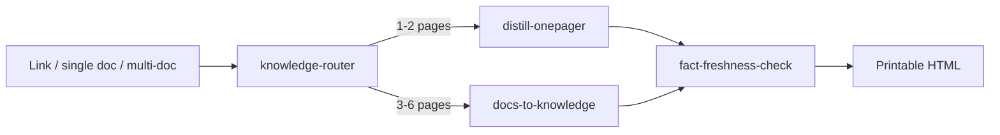

# Knowledge Distillation Skills

Four Agent Skills that turn a link, a long document, or a multi-document knowledge base into a printable, structured HTML knowledge document — and verify version-sensitive claims before publishing.

## Pipeline



- **knowledge-router** — the entry point. Quantifies the input (CJK-equivalent size, H2 subtopics, file count) and routes to one output skill. It also enforces freshness verification and the editorial QA gate.
- **distill-onepager** — hard compression: a single document into 1–2 A4 pages, with a strict character budget, KU scoring, a compression ladder, and one or two mechanism diagrams. The page tier is driven by the number of high-scoring KUs (not by source length); skeletons — peer enumerations, decision chains, quotable scripts — are protected from silent deletion, and a replay test plus assertion-completeness check gate the output.
- **docs-to-knowledge** — structured aggregation: a lead document plus N detail files into 3–6 A4 pages plus a self-contained markmap knowledge graph. It preserves key explanations, quotes, numbers, and honest caveats instead of maximizing compression.
- **fact-freshness-check** — version-freshness audit: extracts version-sensitive claims (defaults, limits, performance conclusions, support ranges, deprecations), checks the current official docs, and returns four states: still valid, evolved, incomplete, unverified. The body is rewritten to the current behavior; the freshness block records the evolution path.

## Routing rules

| Input | Condition | Route |
|---|---|---|
| One link | Any | Fetch into a single document, then apply the single-document rules |
| One document | ≤850 CJK-equivalent units | `distill-onepager` (1 page) |
| One document | 851–3000 | `distill-onepager` (1–2 pages) |
| One document | 3001–8000, H2 ≤4 | `distill-onepager` (2 pages) |
| One document | 3001–8000, H2 ≥5 | `docs-to-knowledge` (3–4 pages) |
| One document | >8000 | `docs-to-knowledge` (4–6 pages) |
| Multiple documents | Total ≥1500 | `docs-to-knowledge` (3–6 pages) |
| Multiple documents | Total <1500 | Ask the user; do not force 3 pages |
| Explicit user choice | Any | User wins; report the compression trade-off |

CJK-equivalent units = Chinese characters + English words × 1.6. One A4 page ≈ 850 units.

## Freshness contract

- The **body** only states the current version's facts. A reader must get the correct answer without any background.
- The **freshness block** records the evolution path (old behavior, which version changed it) and unresolved items. It is a depth layer, not a correction layer.
- `[演进]` means: rewrite the body first, then record the old behavior in the block.
- `[未核实]` means: no evidence; mark it in the body and list it in the delivery report.

## Output format

- Single-file HTML, A4, print-ready; no PDF/DOCX generation.
- `distill-onepager`: 1–2 pages; `docs-to-knowledge`: 3–6 pages plus a markmap graph.
- 9pt minimum, inline SVG diagrams, no CDN or JavaScript dependency for the printable document.
- Footer is optional: if the body already fits the page and only the footer slightly overflows, drop the footer instead of adding a page or shrinking text.
- Editorial QA gate: section contracts, glossary/MECE, cold-reader review, and sibling-heading collision checks.

## Output naming（输出命名）

All generated files use Chinese names:

- `浓缩-<中文主题>.html`
- `知识-<中文主题>.html`
- `知识图谱-<中文主题>.html`
- `时效校验-<中文主题>.md`

主题用 2–12 个中文字概括；不使用英文 slug、拼音或日期缩写。用户显式指定路径时以用户为准，但文件名仍建议中文。

## Install

Keep the four skill directories side by side. `docs-to-knowledge` and `fact-freshness-check` reuse reference files from `distill-onepager`.

```bash
git clone https://github.com/Aaronxx/knowledge-distillation-skills.git
cp -r knowledge-distillation-skills/{knowledge-router,distill-onepager,docs-to-knowledge,fact-freshness-check} ~/.zcode/skills/
```

For Claude Code or another Agent Skills runner, use its skills directory instead of `~/.zcode/skills/`.

## Usage

```text
/knowledge-router <path-or-url>
```

Or in natural language:

- “把这个链接总结成一页知识点”
- “把这些文档整理成知识库”
- “帮我整理这个项目目录”

The router reports: input summary → quantified decision → selected skill → freshness result → editorial QA result → artifacts.

## Verification

- `knowledge-router/scripts/test_router.py`: 9/9 routing regressions.
- `distill-onepager/scripts/check_onepager.py`: page count, character budget, font floor, external resources, freshness block, heading collisions.
- `docs-to-knowledge/scripts/check_knowledge.py`: page count, per-page budget, detail-card coverage, honest markers, markmap self-containment, heading collisions.
- Audit the skills themselves with [skill-authoring-standard](https://github.com/Aaronxx/skill-authoring-standard): `python scripts/audit_skill.py <skill_dir>`.

## Repository layout

```text
knowledge-router/
distill-onepager/
docs-to-knowledge/
fact-freshness-check/
README.md
LICENSE
```

Each skill directory contains `SKILL.md`, `assets/`, `references/`, `scripts/` (where needed), and `eval/`.

## 中文说明

四个 skill 组成一条知识浓缩流水线：

- `knowledge-router`：按输入规模自动选择压缩还是结构化，并强制跑时效校验与编辑质量门。
- `distill-onepager`：单文档 → 1–2 页 A4 知识点，硬预算、强取舍。
- `docs-to-knowledge`：总纲 + 细节集 → 3–6 页结构化知识 + 可交互 markmap 图谱，保留关键说明、话术和诚实标记。
- `fact-freshness-check`：版本敏感断言逐条对照官方当前版文档，正文写当前事实，区块记演进脉络。

安装时四个目录必须放在同一层；`docs-to-knowledge` 和 `fact-freshness-check` 会复用 `distill-onepager` 的参考文件。

## License

MIT. See [LICENSE](LICENSE).
